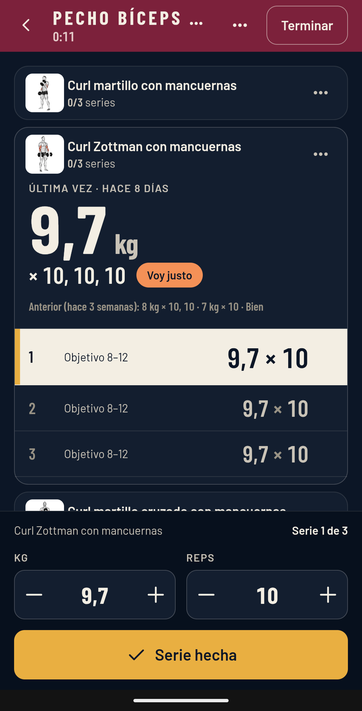
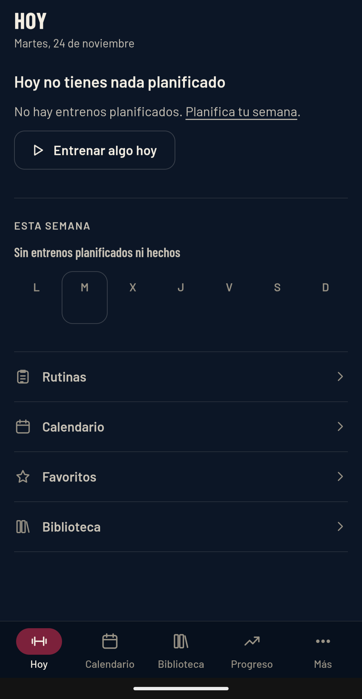
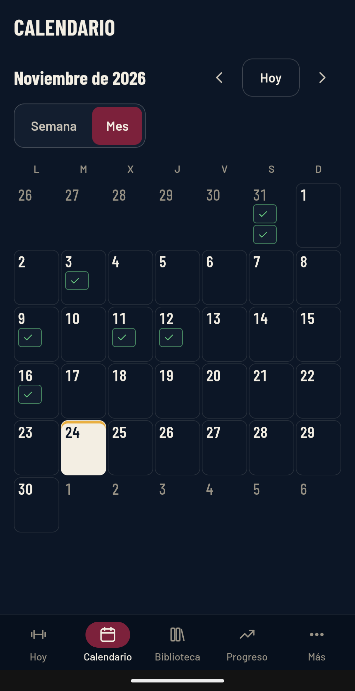
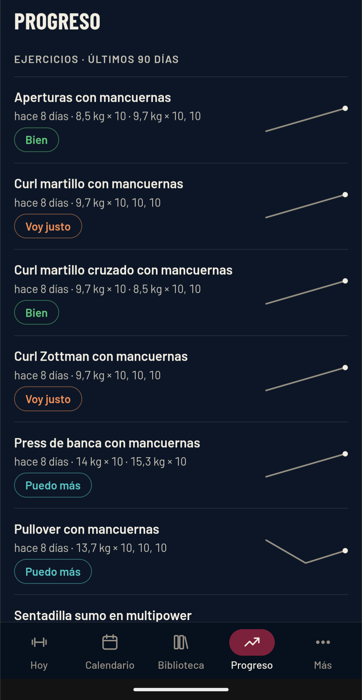
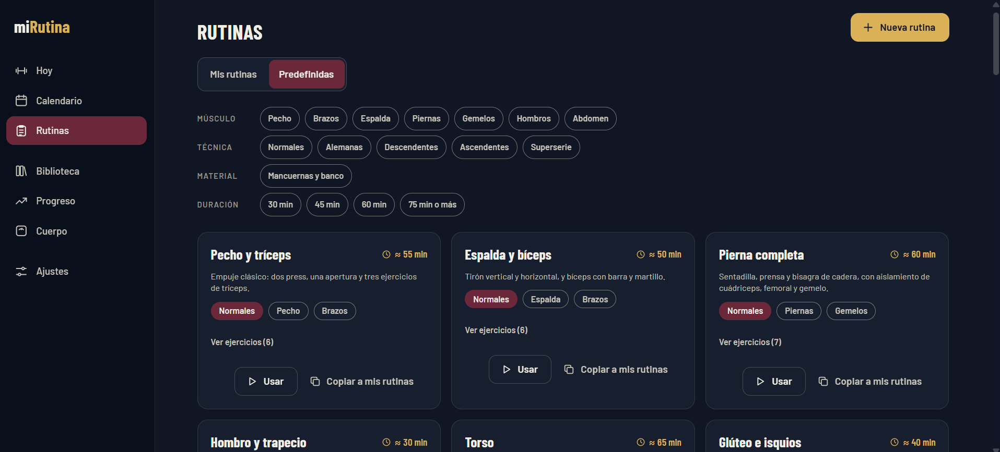
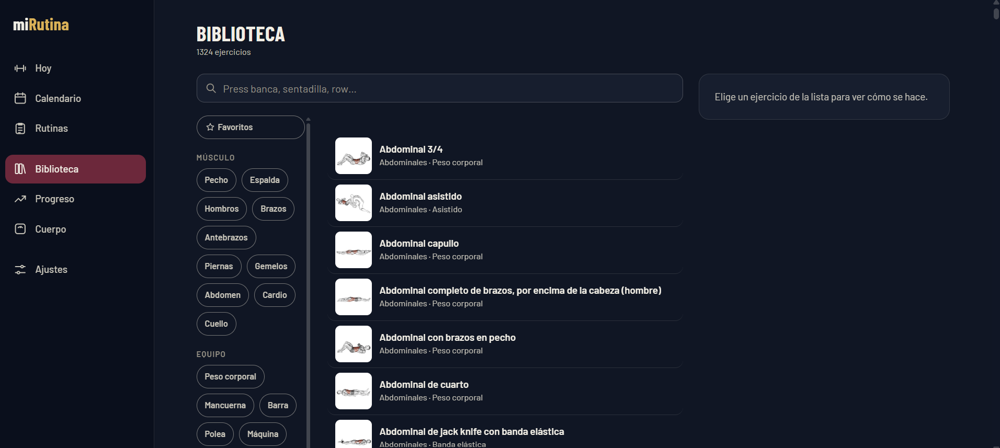

# miRutina

Registro de entrenamiento de fuerza **local-first**: planificas la semana en el PC y registras las series en el móvil, en el gimnasio y sin cobertura. Es una PWA instalable que funciona entera sin conexión y se sincroniza en segundo plano entre dispositivos.

> **Principio de producto:** la app nunca sugiere el peso de hoy. Muestra la última sesión y la anterior (peso, reps y una valoración de sensaciones), precarga esos valores y deja que decidas tú.

## Capturas

| Sesión en curso | Hoy | Calendario | Progreso |
| :---: | :---: | :---: | :---: |
|  |  |  |  |

La sesión en curso muestra la última vez (peso, reps y valoración) y la anterior, y precarga esos valores: un toque en «Serie hecha» registra la serie.

**En el PC:** rutinas predefinidas con filtros por músculo, técnica, material y duración.



**Biblioteca de 1.324 ejercicios** con búsqueda en español e inglés y filtros.



<sub>Imágenes de los ejercicios: © Gym visual — gymvisual.com</sub>

## Funcionalidades

- **Sesión en curso pensada para una mano:** registrar una serie es un toque; la valoración (Demasiado · Voy justo · Bien · Puedo más · Poco) es opcional y arranca el descanso. Se guarda en cada cambio, mantiene la pantalla encendida (Wake Lock) y sobrevive a recargas y cierres.
- **Técnicas de series:** normales, alemanas, descendentes, ascendentes y superseries.
- **Calendario** semanal y mensual con arrastrar y soltar (planificado, hecho, saltado).
- **Editor de rutinas** con arrastrar y soltar, y colección de rutinas predefinidas por músculo, técnica y material.
- **Biblioteca de 1.324 ejercicios** con nombres traducidos al español, búsqueda ES/EN, filtros, GIF y pasos.
- **Progreso:** historial por ejercicio, 1RM estimado (Epley), récords, gráficas, series por grupo muscular y constancia. Todo se calcula a partir de las series; nada se guarda precalculado.
- **Cuerpo:** peso y medidas con media móvil de 7 días.
- **Copia de seguridad** en JSON con importación que fusiona sin duplicar.
- Tema oscuro primero (gimnasio) y claro; diseño adaptado a móvil (navegación inferior) y PC (barra lateral y 2–3 columnas).

## Stack

| Área | Tecnología |
| --- | --- |
| UI | React 19, TypeScript (strict), Vite, TanStack Router |
| Datos locales | Dexie.js (IndexedDB) + `useLiveQuery` |
| Sincronización y auth | Supabase (Postgres, RLS, enlace mágico) |
| Estado efímero | Zustand |
| Estilos y motion | CSS Modules, custom properties, container queries, GSAP (Flip, ScrollTrigger) |
| Gráficas | Recharts |
| Offline | Service worker propio con Workbox (`vite-plugin-pwa`, `injectManifest`) |
| Tests | Vitest + Testing Library, Playwright |

## Arquitectura

```
          UI (React)
     lee siempre de Dexie
             │  useLiveQuery
             ▼
   ┌────────────────────┐   escribe   ┌─────────┐
   │ IndexedDB (Dexie)  │◄────────────│ repos   │
   │ tablas + outbox    │────────────►│ (src/db)│
   └─────────┬──────────┘  1 entrada  └─────────┘
             │ push (lotes) / pull incremental
             ▼
   ┌────────────────────┐
   │ Supabase Postgres  │  RLS: cada fila solo para su dueño
   │ trigger LWW        │  server_updated_at para el pull
   └────────────────────┘
```

- **Local-first:** la interfaz nunca lee de Supabase. Cada escritura va a Dexie y deja una entrada en un *outbox* (una por fila: varias ediciones seguidas = una subida).
- **Sincronización** ([src/sync/engine.ts](src/sync/engine.ts)): el *push* sube el outbox en lotes; el *pull* trae las filas con `server_updated_at` posterior al último pull, así un reloj desajustado en un dispositivo no hace perder cambios. Los conflictos se resuelven con *last-write-wins* sobre `updatedAt`, en el cliente y también en el servidor con un trigger ([supabase/schema.sql](supabase/schema.sql)).
- **Sin borrados físicos:** todas las tablas de usuario usan `deletedAt`, para que los borrados también se sincronicen.
- **Seguridad:** las 7 tablas tienen Row Level Security con `user_id = auth.uid()` en lectura y escritura. La clave del cliente es la *publishable* de Supabase.
- **Offline:** el service worker precarga la app y las miniaturas; los GIF de los favoritos y de las rutinas se guardan aparte para tenerlos en el gimnasio.
- **Motion:** un único conjunto de tokens de duración y easing en [src/styles/tokens.css](src/styles/tokens.css), leído por CSS y por GSAP. Todo respeta `prefers-reduced-motion`.

## Calidad

- 327 tests unitarios y de componentes (cálculos de 1RM y récords, motor de sincronización, repositorios, importación de copias…) y tests e2e con Playwright de los flujos principales.
- TypeScript strict, ESLint y Prettier.
- Contraste AA verificado por test (AAA en las cifras de la sesión), áreas táctiles ≥ 44 px y navegación por teclado en arrastrar y soltar.
- Lighthouse móvil en local: rendimiento 90–92, accesibilidad 100, buenas prácticas 100.

## Puesta en marcha

Requisitos: Node.js 20 o superior y `git`.

```bash
npm install
npm run fetch:media   # descarga imágenes y GIF de los ejercicios (≈ 140 MB, una vez)
npm run dev
```

La app funciona entera sin configurar nada: los datos se quedan en el navegador. Para sincronizar entre dispositivos:

1. Crea un proyecto en [Supabase](https://supabase.com) y ejecuta [supabase/schema.sql](supabase/schema.sql) en el SQL Editor.
2. Copia `.env.example` como `.env.local` y rellena `VITE_SUPABASE_URL` y `VITE_SUPABASE_ANON_KEY`.

El despliegue en Vercel y la instalación en el móvil están en [docs/DESPLIEGUE.md](docs/DESPLIEGUE.md).

| Comando | Qué hace |
| --- | --- |
| `npm run dev` | Servidor de desarrollo |
| `npm run build` | Descarga la media si falta, comprueba tipos y compila |
| `npm run test` / `npm run test:e2e` | Tests unitarios / e2e |
| `npm run lint` · `npm run typecheck` | Calidad |
| `npm run import:exercises` | Regenera el catálogo y las traducciones desde el dataset |

## Estructura

```
src/
  app/         router, layout raíz y providers
  routes/      una carpeta por pantalla (hoy, calendario, sesion, biblioteca, rutinas…)
  components/  componentes compartidos (ui/ = primitivas)
  db/          esquema Dexie, tipos, repositorios y consultas
  sync/        cliente Supabase y motor de sincronización
  lib/         utilidades puras con tests (fechas, 1RM, récords, búsqueda…)
  motion/      tokens y helpers de animación
  sw/          service worker
scripts/       importación del catálogo, traducción de nombres y descarga de media
supabase/      esquema y migraciones
e2e/           tests de Playwright
docs/          planificación, fases y notas de decisiones
```

## Cómo se ha construido

El proyecto se ha desarrollado por fases con [Claude Code](https://claude.com/claude-code) como asistente. El proceso está documentado en el repositorio:

- [docs/PLANNING.md](docs/PLANNING.md): decisiones de producto, fuente de verdad.
- [docs/phases/](docs/phases/): objetivos y criterios de aceptación de cada fase (F0–F7).
- [docs/NOTAS.md](docs/NOTAS.md): registro de decisiones técnicas y auditorías.
- [CLAUDE.md](CLAUDE.md), [PRODUCT.md](PRODUCT.md) y [DESIGN.md](DESIGN.md): reglas de código, producto y diseño.

## Licencia y créditos

El código es [MIT](LICENSE).

- Datos de ejercicios: [hasaneyldrm/exercises-dataset](https://github.com/hasaneyldrm/exercises-dataset) (MIT).
- Imágenes y GIF: **© Gym visual — [gymvisual.com](https://gymvisual.com/)**. No están en este repositorio ni cubiertos por su licencia; se descargan del dataset al compilar y su uso se rige por los términos de Gym visual.
